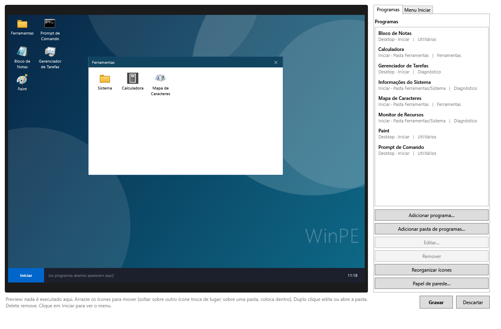
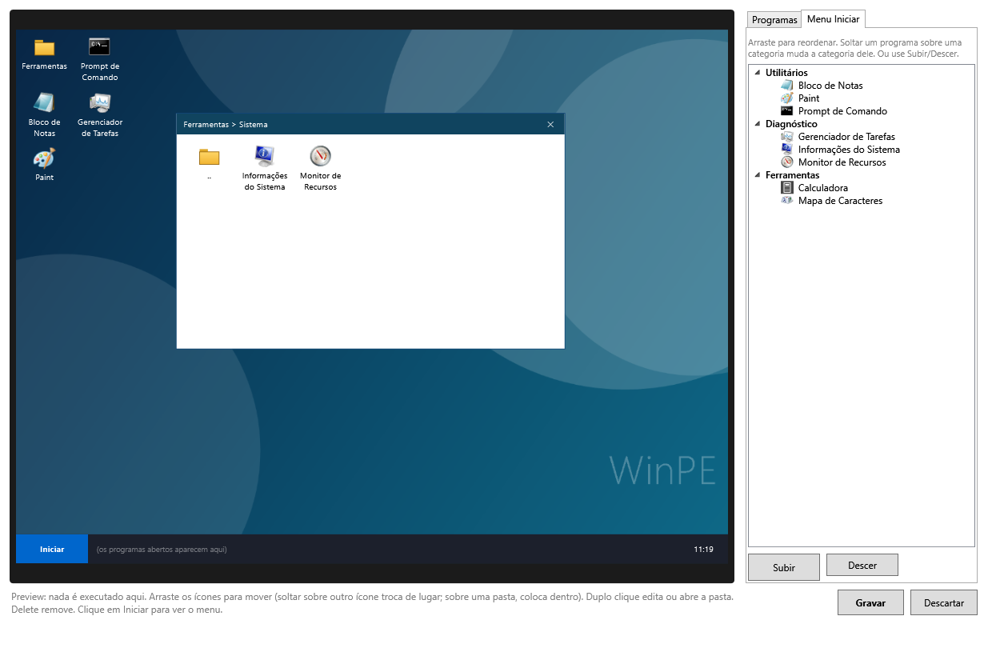
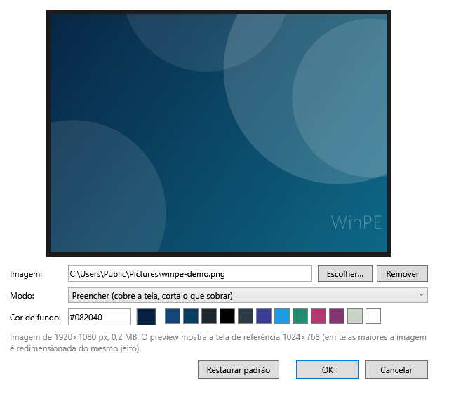

# WinPE Builder

Programa com interface gráfica (C#, .NET 10, WPF) que **gera uma ISO de WinPE** — 32 ou 64 bits, boot BIOS + UEFI — com os seus
arquivos e programas dentro. Ele baixa e instala sozinho o que for preciso (Windows ADK + WinPE add-on, direto da Microsoft) e inclui um
**editor visual**: você monta, arrastando, a área de trabalho e o menu Iniciar que vão aparecer no WinPE, com ícones de verdade.

> **English summary:** WinPE Builder is a Windows GUI (C#/.NET 10/WPF) that builds bootable WinPE ISOs (x86/x64, BIOS+UEFI),
> fetches the Windows ADK for you, injects your files, and ships a tiny WinForms shell (desktop icons, taskbar, Start menu, wallpaper)
> that you design visually with drag and drop. The UI and docs are in Brazilian Portuguese.



## Recursos

- **Gera a ISO completa:** `copype` → monta o `boot.wim` → pacotes opcionais → teclado → `oscdimg` (BIOS + UEFI). Também grava em **pendrive**.
- **Cuida dos requisitos:** detecta o Windows ADK / WinPE add-on e instala (com verificação de assinatura da Microsoft) se faltar.
- **32 e 64 bits.** O ADK atual não tem WinPE x86; o app usa o ADK do Windows 10 2004 ou o `boot.wim` de uma ISO do Windows 32 bits.
- **Pacotes opcionais:** PowerShell, .NET Framework, WMI, scripts, cmdlets de armazenamento/DISM, BitLocker e outros (dependências automáticas).
- **Seus arquivos no WinPE:** pasta mapeada como `Z:` e `%ARQUIVOS%`, com `startup.cmd` opcional que roda sozinho.
- **Programas com ícone** (desktop e menu Iniciar), por um launcher próprio que roda dentro do WinPE.
- **Editor visual** com *preview* fiel, sem executar nada: arrastar, adicionar, remover, **gravar ou descartar**.
- Pastas e **subpastas** na área de trabalho, **ordem manual** do menu Iniciar e **papel de parede** (imagem ou cor).

## Editor visual

No grupo **Programas no WinPE**, clique em **Abrir editor visual…**.

- **Mover:** arraste os ícones (grade de 80 px; tela de referência 1024×768). Soltar sobre outro ícone **troca de lugar**; soltar um programa
  **sobre uma pasta** coloca-o dentro dela.
- **Adicionar:** pelos botões, ou **arrastando `.exe` e pastas do Explorer** direto para a tela. *Adicionar pasta de programas* lista os
  `.exe` da pasta (ignora desinstaladores), deixa marcar para cada um *menu Iniciar* e/ou *área de trabalho* e copia a pasta uma única vez.
- **Editar / remover:** duplo clique edita (numa pasta, abre a janela dela); botão direito oferece editar, colocar em pasta nova, tirar da
  pasta e remover; `Delete` remove, `F2` renomeia pasta.
- **Subpastas:** use `/` no nome da pasta (ex.: `Ferramentas/Discos`, até 4 níveis). Dentro da janela da pasta, duplo clique entra e `..` volta.
- **Menu Iniciar:** clique em *Iniciar* para ver o menu como será. Na aba **Menu Iniciar** reordene categorias e programas
  (Subir/Descer ou arrastando; soltar um programa em outra categoria muda a categoria dele).
- **Papel de parede:** JPG/PNG/BMP (até 25 MB) em Preencher, Ajustar, Esticar, Centralizar ou Lado a lado, mais a cor de fundo.
- **Gravar** aplica tudo; **Descartar** (ou fechar e escolher "Não") joga tudo fora — o editor trabalha numa cópia.





## Como usar

1. Abra `WinPEBuilder.exe` (pede administrador: o DISM precisa para montar o `boot.wim`).
2. **Requisitos:** se faltar algo, use *Instalar ADK (64 bits)* ou *Instalar ADK Win10 2004 (32 bits)*.
3. Escolha a **arquitetura** e a **origem**: *WinPE oficial do ADK* (recomendado, aceita pacotes opcionais e o launcher) ou *boot.wim de uma ISO
   do Windows* (útil para 32 bits; WinPE básico, sem .NET).
4. Marque os **pacotes opcionais**, o **teclado** (padrão pt-BR) e, se quiser, a **pasta de arquivos** e os **programas**.
5. Escolha onde salvar a ISO e clique em **Gerar ISO**. Depois, se quiser, **Gravar em pendrive** (formata o pendrive).

### Seus arquivos dentro do WinPE

- **Na ISO** (recomendado): ficam em `\Arquivos` na mídia e não ocupam RAM. **Dentro da imagem**: ficam em `X:\Arquivos` (RAM, até 1 GB).
- Ao iniciar, o WinPE mapeia a pasta como **`Z:`** e define **`%ARQUIVOS%`**. Se houver `startup.cmd` nela, ele é executado.

### Programas, launcher e .NET

Os programas são copiados para `Arquivos\Programas\<id>` e descritos em `Arquivos\programs.json`. Dentro do WinPE roda o **WinPE Launcher**
(WinForms, .NET Framework 4.8): ícones extraídos dos próprios `.exe`, barra de tarefas com relógio e programas abertos, menu Iniciar por
categoria, Prompt de comando, PowerShell, Reiniciar e Desligar. Ele precisa do pacote **.NET Framework** do WinPE, que o app adiciona sozinho e
que só existe com a origem **ADK**. Com a origem *boot.wim de ISO* os programas são copiados (unidade `Z:`), mas sem desktop/menu.

Testar o launcher no Windows comum (janela normal; não desliga nada):

```powershell
WinPELauncher.exe --preview --manifest "C:\caminho\Arquivos\programs.json"
```

## 32 bits (x86)

A Microsoft removeu o WinPE x86 do ADK moderno; a última versão com ele é o **ADK do Windows 10 2004**, que o app instala numa pasta própria
(`%LOCALAPPDATA%\WinPEBuilder\adk`). Alternativa: origem *boot.wim de uma ISO* com uma ISO do Windows 32 bits.

## Compilar, testar e publicar

Requer o **.NET 10 SDK** no Windows (o launcher `net48` compila pelos pacotes de referência do NuGet, sem SDK extra).

```powershell
dotnet build src/WinPEBuilder.sln
dotnet test  src/WinPEBuilder.sln        # 230 testes (runner simulado; não mexem no sistema)

# executável publicado (a pasta launcher\ vai junto automaticamente)
dotnet publish src/WinPEBuilder.App -c Release -r win-x64 --self-contained -p:PublishSingleFile=true -o publish
```

O app pede administrador pelo manifesto; `dotnet run` de um terminal comum falha por isso — abra o `.exe` pelo Explorer ou de um terminal elevado.
Dados do app em `%LOCALAPPDATA%\WinPEBuilder` (`settings.json`, `logs\`, `downloads\`, `work\`, `adk\`).

## Estrutura do repositório

| Pasta | Conteúdo |
|---|---|
| `src/WinPEBuilder.Core` | Lógica (net10): ADK, montagem da ISO, pendrive, programas, layout/editor (`DesignerModel`), papel de parede |
| `src/WinPEBuilder.App` | Interface WPF: janela principal, editor visual, diálogos |
| `src/WinPEBuilder.Launcher` | Launcher que roda dentro do WinPE (WinForms, net48) |
| `src/WinPEBuilder.Tests` | Testes xUnit (inclusive o contrato `programs.json` Core → launcher) |
| `docs/` | `ARCHITECTURE.md` (mapa do código e armadilhas) e `STATUS.md` (estado, pendências, log) |
| `scripts/`, `config/`, `tools/` | Utilitários e o antigo "WinPE Test Lab" (PhoenixPE/PEBakery; binários não são versionados) |

## Testando numa máquina virtual

A ISO foi testada no QEMU (BIOS e UEFI). Se ela **não inicia** na sua VM, quase sempre é a configuração da VM:

| Sintoma | Causa provável e solução |
|---|---|
| Aparece o logo do Windows e a VM **reinicia sozinha** (em loop) | O CPU virtual não tem `POPCNT`/`SSE4.2`, exigidos pelo WinPE do Windows 11 24H2. Use um modelo de CPU moderno: no QEMU `-cpu max` (ou `host`); em outras VMs, desligue perfis de "compatibilidade" de CPU antigos e use uma versão de hardware virtual recente. |
| Mensagem de memória / erro `0xc0000017` | Dê **pelo menos 1 GB** de RAM (testado; 2 GB é o recomendado). Em Hyper-V, desligue a memória dinâmica ou ponha o valor inicial em 2048 MB. |
| Hyper-V geração 2 não inicia / "The image's hash is not allowed" | Os arquivos de boot são assinados pela *Microsoft Windows Production PCA 2011*. Em *Configurações > Segurança*, use o modelo **Microsoft Windows** (não o "Microsoft UEFI Certificate Authority") ou desligue o Secure Boot. Geração 1 (BIOS) também funciona. |
| Não encontra mídia / vai direto ao shell do firmware | Confira se a ISO está conectada como DVD/CD e se ele é o primeiro dispositivo de boot; em VirtualBox/VMware, ative EFI só se for testar UEFI. |

Exemplo de teste rápido no QEMU (BIOS):

```powershell
& "C:\Program Files\qemu\qemu-system-x86_64.exe" -m 2048 -smp 2 -cpu max -machine q35 -cdrom WinPE_amd64.iso -boot d
```

Para UEFI, acrescente `-drive if=pflash,format=raw,readonly=on,file="C:\Program Files\qemu\share\edk2-x86_64-code.fd"`.

## Estado e limitações (seja o primeiro a testar)

O projeto foi desenvolvido com testes automatizados e verificação visual, e já gerou e iniciou uma ISO real em VM (QEMU). Ainda falta validar:

| Verificado | Ainda não verificado |
|---|---|
| 230 testes com runner simulado (pipeline de build, manifesto, editor, launcher) | Gravação em pendrive (formata o disco) |
| **Geração real pela interface** (copype + DISM + pacotes + `oscdimg`, 10 etapas): ISO de ~670 MB com boot BIOS + UEFI | Instalação do ADK 2004 e WinPE x86 (32 bits) |
| **ISO iniciando no QEMU, em BIOS e em UEFI** (sem Secure Boot), até o desktop, com o launcher rodando dentro do WinPE de verdade (ícones, barra, relógio); funciona com 1 GB de RAM | Boot em hardware real e em Hyper-V, VirtualBox e VMware |
| Interface, editor e launcher (`--preview`) vistos rodando no Windows | Papel de parede, subpastas e ordem do menu dentro do WinPE real |

Relate problemas com o log em `%LOCALAPPDATA%\WinPEBuilder\logs` (e, dentro do WinPE, `X:\Windows\Temp\WinPELauncher.log`).

## Avisos

- Este projeto **não é afiliado à Microsoft**. *Windows*, *WinPE* e *Windows ADK* são marcas e produtos da Microsoft. O app baixa o ADK dos
  servidores da Microsoft e o instala em modo silencioso: usá-lo implica aceitar os termos de licença do Windows ADK.
- Gravar em pendrive **apaga o disco escolhido**; o app só lista discos removíveis, confirma com a letra digitada e recusa o disco do Windows.
- Os programas que você coloca no WinPE são de sua responsabilidade (licenças, origem confiável).

## Desenvolvimento com IA e continuidade

Este repositório segue um padrão de *handoff*: qualquer pessoa ou IA deve ler `AGENTS.md`, `docs/STATUS.md` e `docs/ARCHITECTURE.md` antes de
mexer, e toda mudança de código atualiza `docs/STATUS.md` no mesmo commit (um hook e um workflow do GitHub conferem).
Para ativar o hook localmente: `git config core.hooksPath .githooks`.

## Licença

Ainda não definida pelo autor — enquanto não houver um arquivo `LICENSE`, valem os direitos autorais padrão (todos os direitos reservados).
